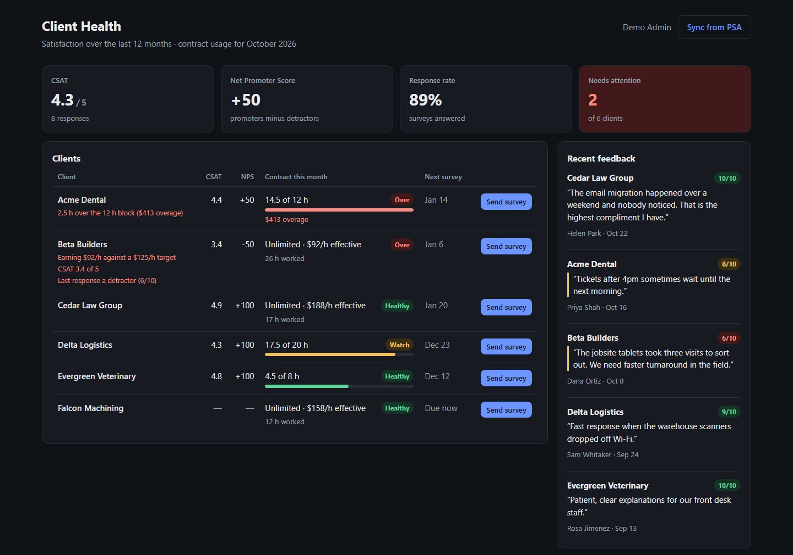
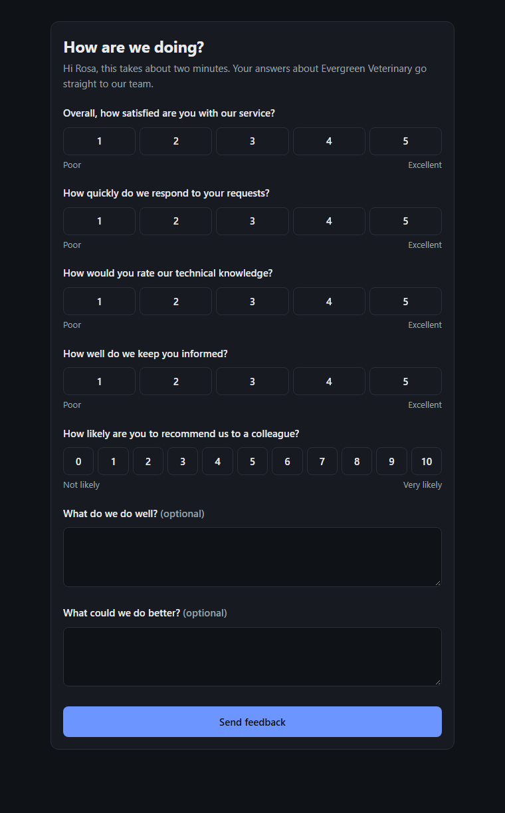
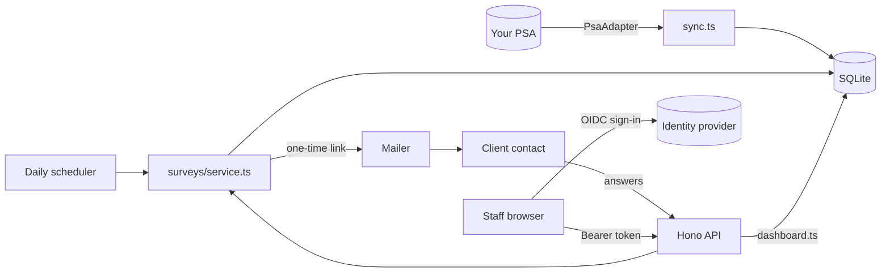

# MSP Client Health

A dashboard for managed IT providers that puts two numbers side by side: how happy each client is, and whether their contract still makes money.

It emails clients a short satisfaction survey on a schedule, tracks CSAT and Net Promoter Score, pulls contract and hours data from your PSA, and flags the clients who need a conversation.



> All clients, people, and numbers in the screenshots are made up.

## Why it exists

A managed IT provider usually learns a client is unhappy when they cancel, and learns a flat-fee client is unprofitable at renewal time. Both signals exist much earlier, just in different places: satisfaction lives in people's heads, and profitability lives in the PSA. This puts them on one screen, once a month, before either becomes a surprise.

## What it flags

| Signal | How it's calculated |
|---|---|
| **CSAT** | Mean of four 1-5 ratings (overall, responsiveness, expertise, communication) over the last 12 months. Below 3.5 is flagged. |
| **NPS** | Standard Net Promoter Score from the 0-10 "would you recommend us" question: percent promoters (9-10) minus percent detractors (0-6). A detractor as the latest response is flagged. |
| **Block-hour contracts** | Hours used against hours bought. 85% used is "watch"; going over is flagged with the overage priced at the contract's rate. |
| **Unlimited contracts** | The flat monthly fee divided by hours actually worked gives an effective hourly rate. Below your target rate (default $125/h) is flagged: that client costs more than they pay. |

## Surveys

Each client gets a survey every 90 days by default (configurable per client), emailed at a set local hour to their primary contact. The client answers on a one-page form with no sign-in:



## How it stays secure

The dashboard shows client revenue and feedback, and the survey link is public by design, so the security work is most of the work.

| Risk | What the app does |
|---|---|
| Someone calls the API directly | Every route except the survey link requires an access token from your identity provider (Okta, Entra ID, Google, Auth0). Signatures, issuer, audience, and expiry are verified with [`jose`](https://github.com/panva/jose). |
| A user claims to be an admin | Roles come only from the verified token's groups claim, never from headers or request bodies. Only the admin group can send surveys, sync, or read the audit log. |
| A survey link leaks or is guessed | Links carry 256 bits of randomness, work once, and expire after 30 days. The database stores only a SHA-256 hash, so a leaked backup contains no working links. The public endpoints are rate-limited by socket address, not a spoofable header. |
| Double submissions | Recording a response is a single conditional `UPDATE`, so two racing submissions cannot both count. |
| Demo settings reach production | `AUTH_MODE=demo`, console mail, and sample data are refused at startup when `NODE_ENV=production`. Missing settings fail at startup, not on the first request. |
| Untracked admin actions | Survey sends and PSA syncs are written to an audit log with the signed-in user's name. |
| Cross-site requests | The API and dashboard are served from one origin with no CORS, plus standard security headers and a 16 KB body limit. |

## Architecture



| Path | Responsibility |
|---|---|
| `src/domain/` | Pure logic: scoring and NPS, contract health, date rules. No I/O. |
| `src/surveys/` | Issuing, opening, and submitting surveys; token hashing |
| `src/http/` | Routes, OIDC token verification, rate limiting |
| `src/store.ts` | All SQL, on Node's built-in `node:sqlite` (no native modules to compile) |
| `src/psa/` | `PsaAdapter` interface and a mock PSA with sample clients |
| `src/dashboard.ts` | Combines satisfaction and contract health into the dashboard view |
| `web/` | React dashboard and survey page, built with Vite and served by the API |

## Run it

Requires Node 22.13 or later.

```bash
npm install
npm run demo
```

Open http://localhost:3000. Demo mode loads sample clients, skips sign-in, and prints survey links to the console instead of emailing them, so you can open one and answer it yourself.

For a real deployment, copy `.env.example` to `.env`, register a single-page app in your identity provider (authorization code with PKCE), then:

```bash
npm run build
npm start
```

## Connecting a real PSA

Implement `PsaAdapter` (`src/psa/types.ts`) for Autotask, ConnectWise, HaloPSA, or whatever you use, and pass it in `src/index.ts` instead of `MockPsa`. It needs four read-only calls: managed companies, their contacts, the active contract, and billable hours for a month. Give it an API account that can read those and nothing else.

## Tests

```bash
npm test           # 72 tests, no network calls
npm run typecheck
```

The tests sign real RS256 tokens with throwaway keys, so the auth tests check actual signature verification: forged, expired, wrong-issuer, wrong-audience, and unsigned tokens are all rejected. CI also runs [gitleaks](https://github.com/gitleaks/gitleaks) on every push.

## How this was built

I built this with Claude Code, Anthropic's AI coding assistant, the same way I build tools for clients: I set the design, the security rules, and the test cases, the assistant drafted code against them, and nothing went in without passing the test suite and my review. I'm responsible for every line.

It is a clean-room version of a client survey tool I built for a managed IT company. No code, client names, or data from that project are included.

## License

MIT
